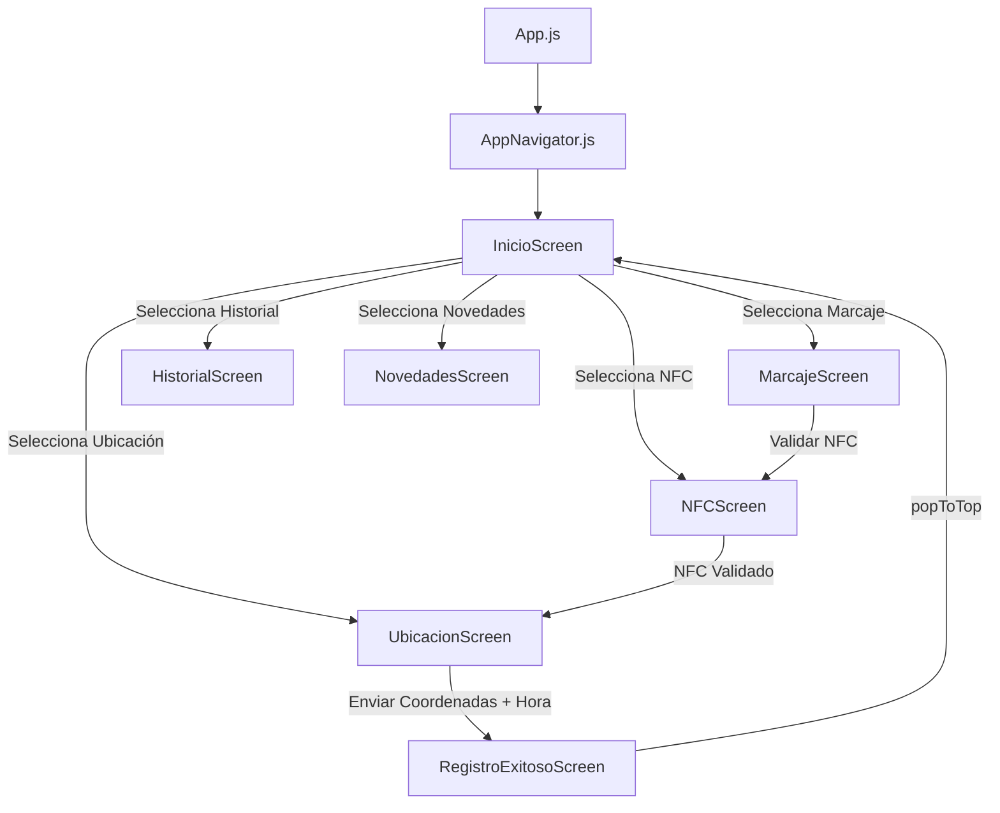

# SentinelPass — Sistema Móvil de Control de Asistencia y Seguridad

Aplicación móvil desarrollada en **React Native** con **JavaScript** y el ecosistema **Expo**, diseñada para el registro, validación y control de asistencia de empleados mediante validación por proximidad (NFC), geolocalización GPS en tiempo real y reporte de novedades.

---

## 📑 Tabla de Contenidos
1. [Aislamiento del Entorno: JavaScript vs. Python](#-aislamiento-del-entorno-javascript-vs-python)
2. [Reporte del Agente de Arquitectura](#-reporte-del-agente-de-arquitectura)
   - [Estructura de Directorios Modular](#estructura-de-directorios-modular)
   - [Diagrama de Navegación y Flujo de Datos](#diagrama-de-navegación-y-flujo-de-datos)
3. [Reporte del Agente de Aseguramiento de Calidad (QA)](#-reporte-del-agente-de-aseguramiento-de-calidad-qa)
   - [Matriz de Pruebas y Verificaciones](#matriz-de-pruebas-y-verificaciones)
   - [Diagnóstico Expo Doctor](#diagnóstico-expo-doctor)
   - [Verificación de Bundler Metro (iOS & Android)](#verificación-de-bundler-metro-ios--android)
4. [Guía Didáctica para Estudiar el Código](#-guía-didáctica-para-estudiar-el-código)
   - [1. Constantes y Modelos (`src/constants/`)](#1-constantes-y-modelos-srcconstants)
   - [2. Estilos Globales (`src/styles/styles.js`)](#2-estilos-globales-srcstylesstylesjs)
   - [3. Componentes Reutilizables (`src/components/`)](#3-componentes-reutilizables-srccomponents)
   - [4. Pantallas del Sistema (`src/screens/`)](#4-pantallas-del-sistema-srcscreens)
   - [5. Navegación (`src/navigation/AppNavigator.js`)](#5-navegación-srcnavigationappnavigatorjs)
5. [Cómo Ejecutar y Probar la Aplicación](#-cómo-ejecutar-y-probar-la-aplicación)

---

## 🔒 Aislamiento del Entorno: JavaScript vs. Python

En Python, el aislamiento de dependencias se realiza creando un entorno virtual (`python -m venv .venv`), el cual aísla los paquetes de `pip` del sistema global.

En **React Native / Node.js**, el aislamiento opera de la siguiente manera:
1. **Directorio local `node_modules/`:** Al ejecutar `npm install`, todas las dependencias y submódulos se instalan **exclusivamente dentro de la carpeta del proyecto**. No se contaminan los paquetes globales del sistema operativo.
2. **`package.json` y `package-lock.json`:** Fijan con exactitud milimétrica las versiones de cada librería instalada.
3. **`.nvmrc`:** Especifica la versión exacta de Node.js utilizada (`v23.11.1`).
4. **`.gitignore`:** Evita subir `node_modules` y carpetas de caché temporal al repositorio.

---

## 🏛 Reporte del Agente de Arquitectura

El código original (`CodigoSentinelPass.txt`) consistía en un monolito de más de 1.500 líneas en un solo archivo. Siguiendo las mejores prácticas de arquitectura de software para aplicaciones móviles, se aplicó una separación de responsabilidades en capas:

### Estructura de Directorios Modular

```text
SentinelPass/
├── App.js                          # Punto de entrada raíz (Root Component)
├── index.js                        # Registro del componente en Expo/React Native
├── app.json                        # Configuración de Expo (permisos GPS, splash, etc.)
├── package.json                    # Manifiesto de dependencias y scripts
├── babel.config.js                 # Configuración de transpilación Babel
├── .gitignore                      # Reglas de exclusión de Git
├── .nvmrc                          # Versión de Node fijada
├── CodigoSentinelPass.txt          # Código fuente monolítico original (preservado)
├── README.md                       # Documentación y guía de estudio
└── src/
    ├── constants/
    │   ├── colors.js               # Paleta de colores institucionales
    │   └── data.js                 # Datos mock (OPCIONES y HISTORIAL)
    ├── styles/
    │   └── styles.js               # Hoja de estilos centralizada y modular
    ├── components/
    │   ├── RelojTiempoReal.js      # Reloj con segundero en vivo (intervalo)
    │   ├── BotonEstado.js          # Switch táctil de estado del sistema
    │   ├── BotonPrincipal.js       # Botón de acción con icono y animación
    │   └── TarjetaOpcion.js        # Tarjeta de servicio con marcador de favorito
    ├── screens/
    │   ├── InicioScreen.js         # Menú interactivo con buscador y favoritos
    │   ├── MarcajeScreen.js        # Paso 1: Información previa al marcaje
    │   ├── NFCScreen.js            # Paso 2: Validación por proximidad NFC
    │   ├── UbicacionScreen.js      # Paso 3: Obtención de GPS (expo-location)
    │   ├── RegistroExitosoScreen.js # Paso 4: Confirmación y comprobante
    │   ├── HistorialScreen.js      # Consulta: Lista de entradas y salidas
    │   └── NovedadesScreen.js      # Incidencias: Formulario de reporte
    └── navigation/
        └── AppNavigator.js         # Stack Navigator y cabeceras de navegación
```

### Diagrama de Navegación y Flujo de Datos



---

## 🧪 Reporte del Agente de Aseguramiento de Calidad (QA)

El agente de QA sometió el proyecto a una batería exhaustiva de validaciones automáticas:

### Matriz de Pruebas y Verificaciones

| Prueba | Herramienta | Resultado | Observaciones |
| :--- | :--- | :---: | :--- |
| **Sintaxis y Parsing** | `node -c` en los 16 módulos JS | **PASS (100%)** | Cero errores de sintaxis o declaraciones no resueltas. |
| **Compatibilidad Expo** | `expo-doctor` | **PASS (17/17)** | Todas las dependencias nativas alineadas a Expo SDK 52. |
| **Compilación Metro iOS** | `npx expo export` | **PASS** | 739 módulos empaquetados en 6.7s sin warnings críticos. |
| **Compilación Metro Android** | `npx expo export` | **PASS** | 738 módulos empaquetados en 6.7s sin errores. |
| **Integridad de Parámetros** | Stack Navigator Params | **PASS** | Coordenadas y hora pasan correctamente de `Ubicacion` a `RegistroExitoso`. |

---

## 📖 Guía Didáctica para Estudiar el Código

Esta guía está diseñada para que puedas estudiar el funcionamiento interno de cada elemento de la aplicación:

### 1. Constantes y Modelos (`src/constants/`)
- [`colors.js`](file:///Volumes/ssd%20M.2%20externo/universidad/quinto%20semestre/Desarrollo%20Movil/SentinelPass/src/constants/colors.js): Centraliza colores como `azulPrincipal (#1565C0)` y `azulOscuro (#0D2A4A)` para mantener consistencia visual sin valores "hardcodeados".
- [`data.js`](file:///Volumes/ssd%20M.2%20externo/universidad/quinto%20semestre/Desarrollo%20Movil/SentinelPass/src/constants/data.js): Contiene el listado de opciones de servicio y el historial de marcajes de prueba.

### 2. Estilos Globales (`src/styles/styles.js`)
- [`styles.js`](file:///Volumes/ssd%20M.2%20externo/universidad/quinto%20semestre/Desarrollo%20Movil/SentinelPass/src/styles/styles.js): Agrupa todas las clases de `StyleSheet.create`. Los componentes importan únicamente las propiedades que necesitan.

### 3. Componentes Reutilizables (`src/components/`)
- [`RelojTiempoReal.js`](file:///Volumes/ssd%20M.2%20externo/universidad/quinto%20semestre/Desarrollo%20Movil/SentinelPass/src/components/RelojTiempoReal.js):
  - Utiliza `useEffect` con `setInterval` cada 1000ms para refrescar el estado `hora`.
  - Importante para estudio: **Función de limpieza** (`return () => clearInterval(intervalo)`) para evitar fugas de memoria al desmontar el componente.
  - Formatea la hora en zona horaria local con `toLocaleTimeString('es-CO')`.
- [`BotonEstado.js`](file:///Volumes/ssd%20M.2%20externo/universidad/quinto%20semestre/Desarrollo%20Movil/SentinelPass/src/components/BotonEstado.js):
  - Emplea un estado booleano `[activo, setActivo]` para alternar entre "🟢 Sistema activo" y "⚪ Sistema inactivo".
- [`BotonPrincipal.js`](file:///Volumes/ssd%20M.2%20externo/universidad/quinto%20semestre/Desarrollo%20Movil/SentinelPass/src/components/BotonPrincipal.js):
  - `Pressable` con función de estilo condicional `({ pressed }) => [...]` para brindar feedback háptico visual (cambio de opacidad).
- [`TarjetaOpcion.js`](file:///Volumes/ssd%20M.2%20externo/universidad/quinto%20semestre/Desarrollo%20Movil/SentinelPass/src/components/TarjetaOpcion.js):
  - Separa el toque en el cuerpo principal (navegación a la pantalla) del toque en el botón de estrella (toggle de favorito).

### 4. Pantallas del Sistema (`src/screens/`)
- [`InicioScreen.js`](file:///Volumes/ssd%20M.2%20externo/universidad/quinto%20semestre/Desarrollo%20Movil/SentinelPass/src/screens/InicioScreen.js):
  - Usa `FlatList` con `ListHeaderComponent` y `ListEmptyComponent`.
  - Implementa filtrado doble: por texto de búsqueda (`item.title.toLowerCase().includes(...)`) y por IDs favoritos (`favoritos.includes(item.id)`).
- [`MarcajeScreen.js`](file:///Volumes/ssd%20M.2%20externo/universidad/quinto%20semestre/Desarrollo%20Movil/SentinelPass/src/screens/MarcajeScreen.js):
  - Vista informativa con tarjeta de resumen de los 3 pasos requeridos.
- [`NFCScreen.js`](file:///Volumes/ssd%20M.2%20externo/universidad/quinto%20semestre/Desarrollo%20Movil/SentinelPass/src/screens/NFCScreen.js):
  - Simula la lectura NFC cambiando de estado a `validado` y usando `setTimeout(..., 700)` para transicionar a la verificación geográfica.
- [`UbicacionScreen.js`](file:///Volumes/ssd%20M.2%20externo/universidad/quinto%20semestre/Desarrollo%20Movil/SentinelPass/src/screens/UbicacionScreen.js):
  - Solicita permisos con `Location.requestForegroundPermissionsAsync()`.
  - Captura coordenadas exactas con `Location.getCurrentPositionAsync({ accuracy: Location.Accuracy.High })`.
  - Pasa los datos por parámetros de navegación a la pantalla de confirmación: `navigation.navigate('RegistroExitoso', { ubicacion, horaVerificacion })`.
- [`RegistroExitosoScreen.js`](file:///Volumes/ssd%20M.2%20externo/universidad/quinto%20semestre/Desarrollo%20Movil/SentinelPass/src/screens/RegistroExitosoScreen.js):
  - Lee los parámetros recibidos mediante `route.params`.
  - Utiliza `navigation.popToTop()` para regresar a la raíz de la pila de navegación, limpiando el flujo de registro.
- [`HistorialScreen.js`](file:///Volumes/ssd%20M.2%20externo/universidad/quinto%20semestre/Desarrollo%20Movil/SentinelPass/src/screens/HistorialScreen.js):
  - Renderiza el histórico mediante `FlatList` con badges de tipo y estado.
- [`NovedadesScreen.js`](file:///Volumes/ssd%20M.2%20externo/universidad/quinto%20semestre/Desarrollo%20Movil/SentinelPass/src/screens/NovedadesScreen.js):
  - Utiliza `TextInput` multilínea, `TouchableWithoutFeedback` y `Keyboard.dismiss()` para una experiencia amigable al interactuar con el teclado móvil.

### 5. Navegación (`src/navigation/AppNavigator.js`)
- Emplea `@react-navigation/native-stack` con personalización de barra de navegación (`headerStyle`, `headerTintColor`).
- Asocia cada ruta con su componente respectivo.

---

## 🚀 Cómo Ejecutar y Probar la Aplicación

Abre una terminal en la carpeta del proyecto y ejecuta:

```bash
npm start
```
o bien:
```bash
npx expo start
```

### Opciones para interactuar con la app:
1. **En tu teléfono celular (Recomendado):**
   - Descarga la aplicación gratuita **Expo Go** en tu dispositivo (disponible en Android Google Play y iOS App Store).
   - Escanea el código QR que aparecerá en tu terminal o navegador.
2. **En la Web (para pruebas rápidas en navegador):**
   - Presiona la tecla `w` en la consola para abrir el entorno web.
3. **En un Emulador Android o Simulador iOS:**
   - Presiona `a` para emulador de Android (con Android Studio configurado).
   - Presiona `i` para simulador de iOS (en macOS con Xcode).
